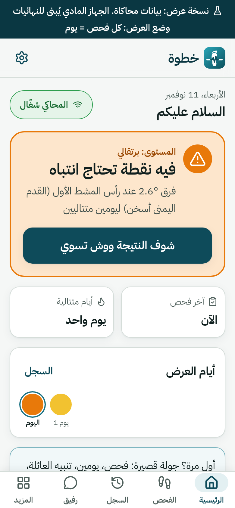
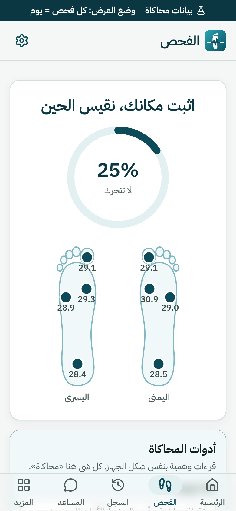
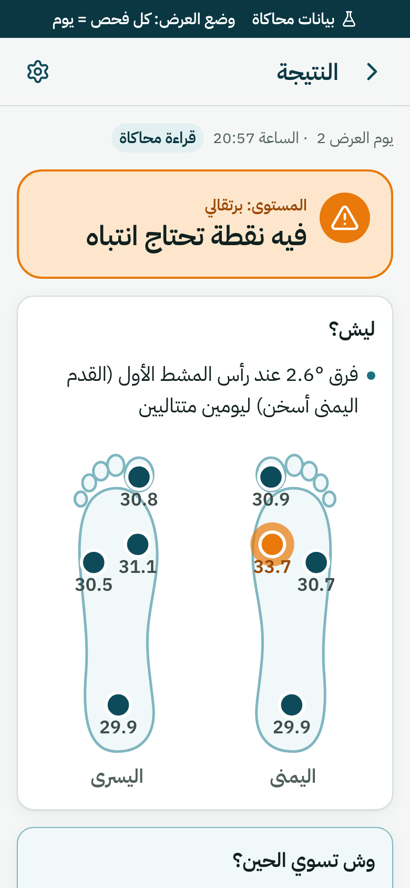
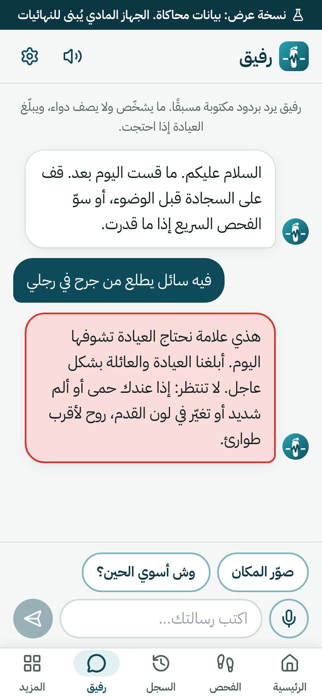
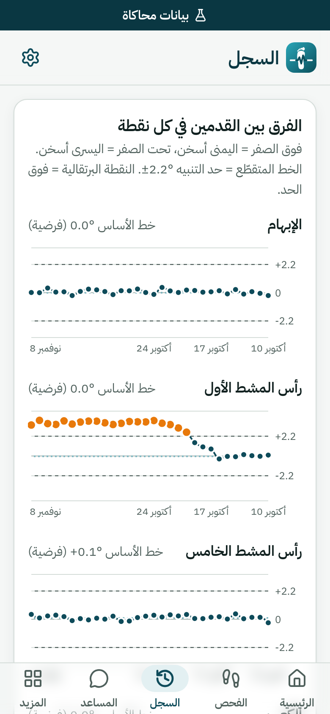
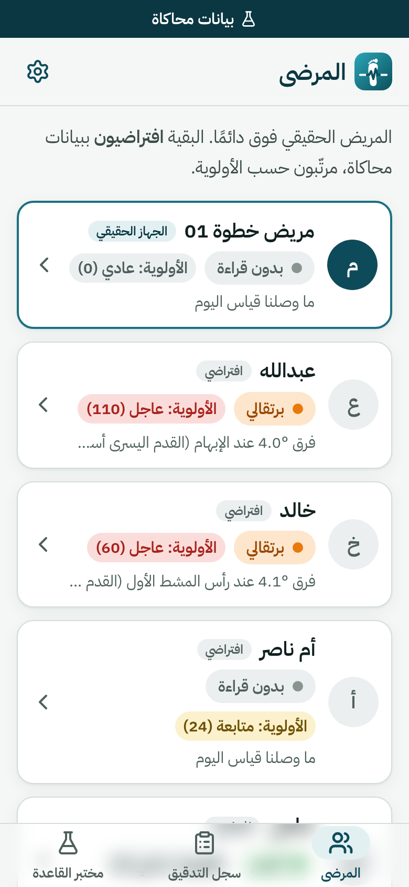
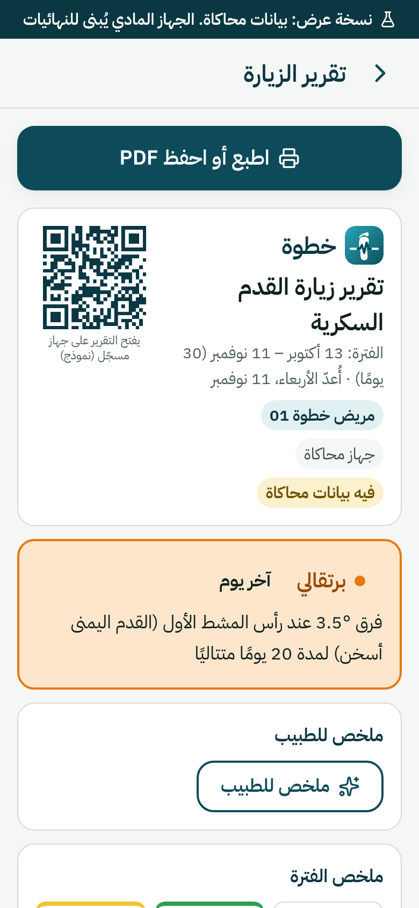
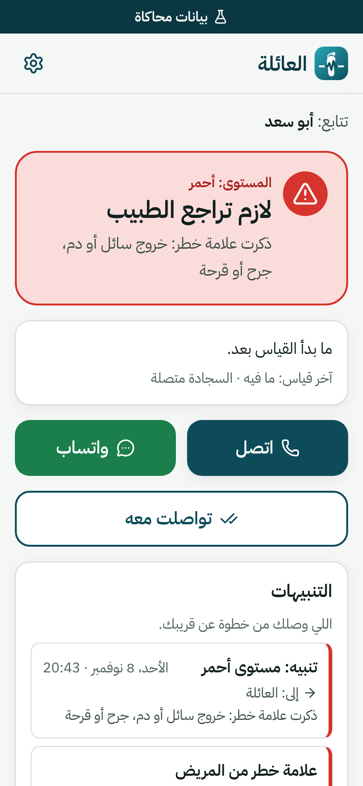
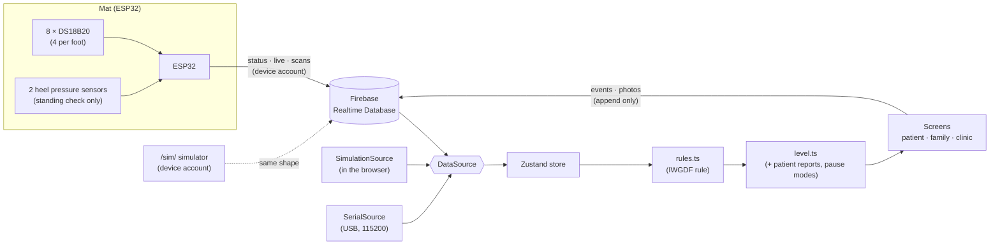

# Khatwa (خطوة)

[](https://github.com/Faisalmoh99/khatwa/actions/workflows/ci.yml)

**A mat placed where people do wudu.** A person with diabetes stands on it once a day, before wudu. It measures the temperature of 4 points on each foot and compares the two feet. When the same point is **more than 2.2 °C warmer on the same foot for two consecutive days** (IWGDF guidance), the app alerts the patient, then the family, then the clinic, in Arabic.

> **A monitoring tool that supports referral. Not a diagnostic device.** The prototype has not been clinically tested.

Team Khatwa · MEDATHON 2026 (SYHF, Jeddah).

| Home | Live scan | Result | Assistant |
|---|---|---|---|
|  |  |  |  |
| **History** | **Clinic** | **Visit report** | **Family** |
|  |  |  |  |

All screenshots are generated by the Playwright tests at iPhone size (390×844) and carry the «بيانات محاكاة» (simulated data) banner where they use the simulator.

## How it works



- **The device measures and sends. It never decides.** The decision is made in the app by one rule engine, `web/src/lib/rules/rules.ts` (a TypeScript port of `app/js/rules.js`, kept identical by a parity test).
- **Red only comes from the patient** (a wound or blister in the quick check, or a red flag in chat). The sensors can raise yellow or orange, never red.
- Every screen depends on one `DataSource` interface. Switching between the real mat, the in-browser simulator and the USB cable never changes a screen; anything that is not the real mat shows a permanent banner.
- Alerts are written once as `escalation` events: to whom, when (server time) and why. The clinic reads them as an audit log.

More detail: [docs/ARCHITECTURE.md](docs/ARCHITECTURE.md) · data contract: [docs/DATA_SCHEMA.md](docs/DATA_SCHEMA.md).

## Built vs. coming

| Built now | Coming (shown as «إصدار قادم», no numbers, no logic) |
|---|---|
| 4 temperature sensors per foot, 1 pressure sensor under each heel (standing check) | Pressure map of the whole foot |
| IWGDF rule (> 2.2 °C, same point, same foot, 2 consecutive days) with quality checks: one foot, movement, wet foot, faulty sensor, whole-foot difference | Perfusion measurement |
| Adherence ladder: reminder → family → clinic, pause modes (travel, bandage, hospital) | AI analysis of foot photos (photos are stored for the clinic only) |
| Assistant with fixed templates, Arabic voice output and voice input | Real push notifications (today: in-app reminder) |
| Family WhatsApp message (wa.me), clinic list, audit log, visit report with QR and PDF | Medical-grade temperature sensors (TMP117) |
| Rule lab on synthetic patients (labelled "simulation, numbers from our assumptions") | |
| AI (Claude Haiku): understands the patient's free text as one of 7 fixed reports, and an optional doctor summary labelled «ملخص آلي، راجع الأرقام» | |
| ESP32 firmware: stand detection, stability, -127/85 handling, offline queue, USB line; contract-tested | |
| Installable PWA that opens offline | Android app (Capacitor) |

## Repository

```
web/                 the app (Vite + React + TypeScript strict + Tailwind)
  src/lib/rules/     rule engine (rules.ts) + tests
  src/lib/           level, ladder, escalations, assistant, report, rule lab (pure, unit-tested)
  src/data/          DataSource + Firebase / Simulation / Serial sources, zod contract
  src/screens/       patient, family, clinic screens
  e2e/               Playwright tests and iPhone screenshots
  scripts/           rules tests (emulator), device data checker, icons, legacy copy
app/                 first prototype (served at /legacy/), simulator /sim/, /dev/live.html, /story/
firmware/            ESP32 code (secrets.h is git-ignored)
firebase/            Realtime Database rules
docs/                plan, progress, data contract, setup, review, architecture
tests/               legacy rule tests (node:test)
```

## Run it

```bash
cd web
npm install
npm run dev                 # http://localhost:5173
# open http://localhost:5173/?source=sim&as=patient   → in-browser simulator, no internet needed
```

| Command (in `web/`) | What it does |
|---|---|
| `npm test` | Unit tests (Vitest): rule engine + parity with `rules.js`, levels, ladder, escalations, assistant, report, rule lab |
| `npm run e2e` | Playwright at iPhone size: every screen, quality scenarios, accessibility (axe), PWA/offline |
| `E2E_FIREBASE=1 E2E_DEVICE_PASSWORD=… npm run e2e` | Real Firebase: legacy `/sim/` → app live view → result, and an event round trip |
| `npm run test:rules` | Firebase rules on the local emulator (15 cases, incl. JSON built by the firmware) |
| `npm run check:device` | Read-only check of what the device wrote to Firebase against the data contract |
| `npm run lint` / `npm run build` | ESLint + Prettier / production build (also copies the legacy pages) |

The legacy rule tests still run from the repo root: `npm test`. CI runs everything on every push.

## Security and data

- Database rules: only the device account can write `status`, `live` and `scans`; scans are append-only; the app can only append `events` and `photos`; nothing can be deleted; every field is type-checked and unknown fields are rejected. Tested on the emulator before deploy.
- Any text from Firebase is rendered as text, never as HTML (enforced by an ESLint rule).
- Consent screen with separate opt-ins for photos and family sharing. In this prototype data is stored in Firebase (Europe); a real deployment needs storage in Saudi Arabia and a PDPL review.

## Test results

_Filled in after measuring (11–12 November). No scan time or accuracy figure is claimed before it is measured._

| Test | Method | Target | Result |
|---|---|---|---|
| Calibration | All sensors in 35–37 °C water with a Beurer FT09 medical thermometer | within ±0.5 °C | |
| Accuracy | Each point vs. the thermometer | mean difference ≤ 0.5 °C | |
| Hot spot | Warm compress on one point before standing, 10 times | 10/10 | |
| Scan time | 10 scans | under 60 s | |
| Wet foot | Wet, after towel, after 30 s | define the instruction | |

## Transparency

- **AI in development:** parts of the code and documentation were written with Claude (Anthropic) under the team's review.
- **AI in the product:** Claude Haiku is used for two narrow jobs, through a Netlify Function (key kept in Netlify, never in the repo):
  1. Classifying the patient's **free text** (never buttons) into one of 7 fixed reports (wound, blister, swelling, fever, new pain, redness, none). It is not called when the templates already found a clear red flag. The patient always gets a fixed template reply; when AI and templates disagree, the more serious wins; redness/new pain only asks the patient to confirm in the quick check.
  2. An optional **doctor summary** of the report numbers, only when "ملخص للطبيب" is pressed, labelled «ملخص آلي، راجع الأرقام».

  **The AI never sets or lowers a risk level** (that is `rules.ts` plus the patient's report). Text ≤ 300 characters, 30 requests per phone per day; any failure falls back silently to the templates. Photos are never analysed.
- **Simulated numbers:** the rule lab compares alert rules on synthetic patients; its numbers come from our assumptions, listed on the screen. Virtual clinic patients are labelled «افتراضي».

---

## بالعربي (مختصر)

**خطوة** سجادة عند مكان الوضوء، يقف عليها مريض السكري كل يوم قبل الوضوء. تقيس حرارة 4 نقاط في كل قدم وتقارن القدمين. إذا صار الفرق في نفس النقطة **أكبر من 2.2°م ليومين متتاليين** ونفس القدم هي الأسخن (توصية IWGDF)، ننبّه المريض ثم العائلة ثم العيادة.

- **أداة مراقبة تدعم الإحالة، مو تشخيص.** النموذج ما اختُبر سريريًا.
- **مبني الآن:** 4 حساسات حرارة لكل قدم، وحساس ضغط تحت كل كعب للتأكد من الوقوف، وقاعدة IWGDF، وسلّم المتابعة، والمساعد بقوالب ثابتة، وتقرير الزيارة، وواجهة العائلة والعيادة، والتطبيق يشتغل بدون نت.
- **إصدار قادم:** خريطة الضغط، والتروية، وتحليل الصور بالذكاء الاصطناعي، والإشعارات الحقيقية، وحساسات TMP117.
- **الشفافية:** استُخدم Claude في كتابة أجزاء من الكود والوثائق. وفي التطبيق: Claude Haiku يفهم كلام المريض الحر ويحوّله لواحد من 7 بلاغات ثابتة، ويكتب ملخص اختياري للطبيب. **ما يغيّر مستوى الخطر أبدًا**، والرد للمريض دايمًا من القوالب. أرقام مختبر القاعدة من افتراضاتنا.

التشغيل: `cd web && npm install && npm run dev` ثم افتح `localhost:5173/?source=sim&as=patient`.
