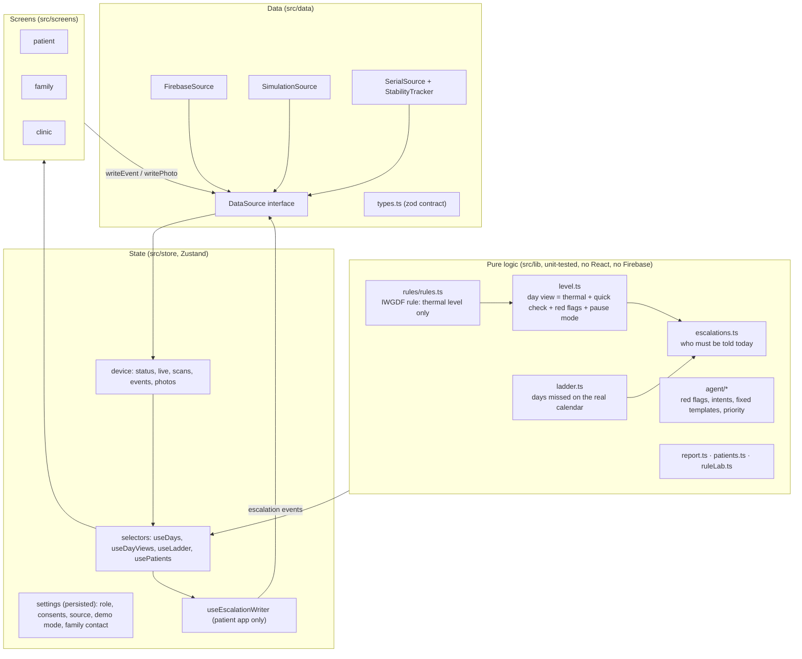

# Architecture (web/)

## Layers

## Decisions that must not move

| Rule | Where |
|---|---|
| Thermal level only from `rules.ts` (> 2.2 °C, same site, same warmer foot, 2 consecutive days) | `src/lib/rules/rules.ts` (+ parity test with `app/js/rules.js`) |
| Red only from a patient report, never from sensors; a report can only raise a level | `src/lib/level.ts` (`levelOf`) |
| Two behaviours waiting for clinical review (whole-foot warming, which scan represents a day) | `POLICY` in `rules.ts`, `test.todo` in `rules.test.ts` |
| The assistant never diagnoses or prescribes; free text is only classified | `src/lib/agent/*` |
| Text from Firebase is never rendered as HTML | ESLint `no-restricted-syntax` rule |

## Day, level and alert flow

1. `buildDays(scans)` groups scans by Riyadh day (or by demo day in demo mode) and `evaluate()` applies the rule.
2. `buildDayViews()` adds the patient's own reports (quick check, chat red flags) and the pause mode in force, and always includes today.
3. `ladderState()` counts missed days on the real calendar (pause days excluded; today counts after the reminder time).
4. `dueEscalations()` lists who must be told today; `useEscalationWriter` writes each one once (`key = day|reason|recipient`).
5. Family and clinic read the same events; the clinic audit log is just those events, newest first.

## Offline and updates

- The service worker (vite-plugin-pwa) precaches the app shell and every screen chunk; legacy pages (`/sim/`, `/dev/`, `/story/`, `/legacy/`) are excluded from the app fallback.
- Firebase RTDB has no web offline persistence, so the last scans and events are kept on the phone (`src/data/cache.ts`) and shown with a "no connection" banner until live data returns. The escalation writer never runs on cached data.
- New versions are offered with an "update available" prompt, never swapped silently.

## Deploy and rollback

- Netlify builds `web/` and publishes `web/dist`; `scripts/copy-legacy.mjs` copies the legacy pages so their URLs keep working.
- Pull requests get a Deploy Preview; the production URL changes only when `web-app` is merged into `main`.
- Rollback: Netlify → Deploys → the last deploy before the switch → "Publish deploy". The first prototype stays available at `/legacy/`.
